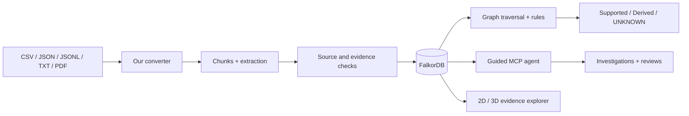
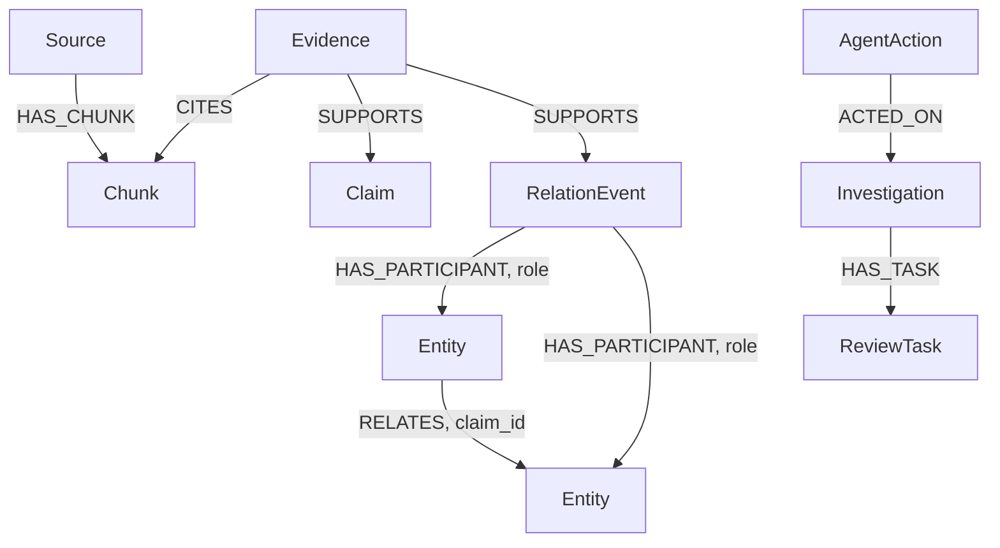
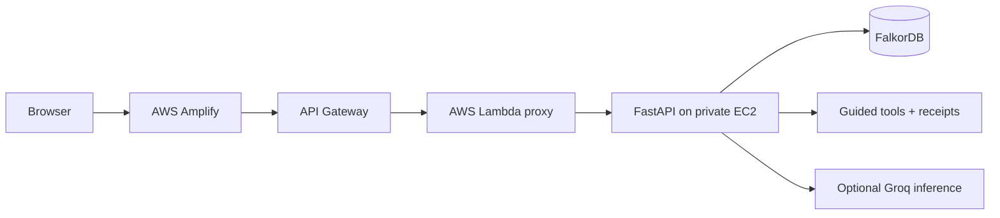

# Graphynx AI

### Follow the evidence. Read the path.

**An evidence-first graph intelligence system, built for Graph Hacks 2026 with FalkorDB.**

[**Try the live demo**](https://main.d6ybcxya0jl1.amplifyapp.com) · [**Source code**](https://github.com/divyashy20-boop/graph-hacks-2026) · [**3-minute demo guide**](DEMO_GUIDE.md) · [**Graph architecture**](docs/UNIVERSAL_ARCHITECTURE.md)

**Hackathon tracks:** Agents That Act on Connected Data · Agent Memory and Coordination · Company Brain

> **In one line:** We built our own converter that turns files into an evidence-linked graph, then gave an AI agent tools to explore those connections, explain its findings, and admit when the evidence is not enough.

## The problem we wanted to solve

Imagine an incident report saying that checkout is failing, another document explaining which services checkout depends on, and a spreadsheet listing service owners. The answer may be somewhere in those files, but connecting the pieces is difficult.

An LLM can summarize each document. That does not mean it can reliably tell us **why two things are connected**, **which source supports a claim**, or **whether a possible relationship is actually true**.

We wanted to make connected information useful without asking people to blindly trust a generated answer.

## What we built

Graphynx converts supported documents and structured files into a persistent FalkorDB knowledge graph. It keeps the source evidence attached to the relationships, not just the names of the entities.

Our system has six parts:

1. **Our own graph converter.** Reads CSV, JSON, JSONL, TXT and text-based PDF files, creates source/chunk records, extracts entities and relationships, and checks what can be supported by the original content.
2. **Evidence-first graph storage.** Keeps entities, claims, original passages, time qualifiers, multi-participant events and review records connected in FalkorDB.
3. **A relationship resolver that can say UNKNOWN.** Distinguishes direct source assertions, contradictions, valid rule-derived answers, connections that prove nothing by themselves, and hypotheses that still need evidence.
4. **A guided graph agent.** Uses bounded graph traversal and controlled MCP tools to search, inspect evidence and investigate dependencies. An explicitly authorized investigation can create persistent cases and review tasks.
5. **Context that can be revisited.** Optional identity revisions keep source history intact. Guided-agent evidence receipts can be rechecked and marked stale or unknown when the underlying information changes.
6. **An interactive website.** Explore real graph records in a 2D map or 3D orbit, inspect supporting sources, filter by date, run relationship checks and open investigation results.

The same core graph engine is demonstrated on **IT incidents, supply chains, and research/identity records**, rather than building one hard-coded flow for every use case.

## Try it yourself

**Live site:** https://main.d6ybcxya0jl1.amplifyapp.com

A short demo journey:

1. Select **IT incident**, then click **Load evidence**.
2. Switch between the **2D Map** and **3D Orbit** views. Pick an entity or relationship and inspect the supporting source passage.
3. Ask whether one service **transitively depends on** another. The system can show a supporting multi-hop path rather than making up a direct edge.
4. Ask about a relation that has no direct proof. The answer should make the uncertainty visible, such as `CONNECTED_ONLY` or `UNKNOWN`.
5. Open an investigation and see how evidence and review records connect to the graph.

Try the **Supply chain** and **Research & identity** examples too. Some datasets may be empty until their source records have been uploaded. Selecting a preset does **not** automatically populate persistent FalkorDB data.

The live demonstration is a bounded hackathon deployment. It is not an always-on commercial service and may be paused after the event.

**Demo video:** Add the team's public or unlisted YouTube URL here before final submission.

## How Graphynx works



### 1. A converter we designed ourselves

We did not just send a document to a model and draw whatever edges it returned.

Our converter creates source-aware records and uses deterministic extraction plus optional model assistance. Extracted candidates are checked against the input, including source passages and qualifiers, before becoming supported graph claims. Unsupported or ambiguous candidates can be kept for review.

The system can preserve **negation, possibility, direction, dates and multi-participant statements**. For example, a single agreement involving several organizations is represented as an event with participant roles, rather than inventing a collection of unrelated pairwise claims.

We also worked on entity resolution. Similar names are not automatically the same identity, and some identity changes can be tracked and reversed without deleting the original source records.

### 2. Better model-assisted extraction, with boundaries

We tested different extraction configurations and selected **GPT-OSS 120B through GroqCloud** for the deployed P2 extraction setup.

Our Groq adapter uses strict structured JSON output for extraction, a low reasoning-effort configuration, input/output limits, request and token budgets, and fail-closed validation. The model helps interpret text; it is **not allowed to turn a guess into a source-backed fact**.

Our selection came from a small controlled benchmark. It is **not** a claim of universal accuracy on unseen documents. Details: [Groq P2 release notes](GROQ_P2_RELEASE.md), [evaluation material](evaluation/), and [converter audit](CONVERTER_AUDIT.md).

### 3. A resolver that understands the difference between a path and proof

Suppose `Checkout → Auth → Cache` is a supported dependency chain.

- `TRANSITIVELY_DEPENDS_ON` can be **RULE_DERIVED** from the directed path, with supporting claim IDs.
- A question about a **direct** `DEPENDS_ON` edge does not become true just because a longer path exists.
- A question about friendship, collaboration or causation cannot be answered merely because two nodes share a neighbor.
- When the evidence is missing, we return `UNKNOWN` or explain why the graph is only `CONNECTED_ONLY`.
- With explicit opt-in, the system may create or suggest a **HYPOTHESIS**. It stays clearly separate from verified or rule-derived claims.

Traversal is bounded by hop and expansion limits, checks direction and applicable time intervals, and excludes unsupported or conflicting claims from proofs.

### 4. An agent that works with graph tools

Our MCP adapter provides controlled tools for **entity search**, **relationship evaluation**, **claim evidence retrieval** and **dependency investigation**. The guided agent uses a bounded rulebook to decide what to inspect, rather than allowing arbitrary Cypher or unrestricted actions.

Some investigations can persist an `Investigation` with linked `ReviewTask` records, but only behind explicit authorization and server-side opt-in. A saved action is an actual graph record, not just a generated paragraph.

The optional receipt-based memory component records the evidence used by supported guided reads. It can check freshness later and report `VALID`, `STALE` or `UNKNOWN`. This is useful when new information arrives after an earlier answer. It is not a claim of fully autonomous multi-agent coordination or automatic external action execution.

## How FalkorDB powers the project

FalkorDB is the **connected context layer**, not a decorative storage service.

Every useful result needs more than an extracted subject and object. We need the relationship, its source, an exact evidence record, possible or negative qualifiers, relevant time, and the actions taken after investigating it.

### Our graph data model



Our typed records include `Source`, `Chunk`, `Entity`, `Claim`, `Evidence`, `RelationEvent`, `Investigation` and `ReviewTask`. They carry stable IDs and payloads. An entity-to-entity `RELATES` edge carries a claim ID so the full source-backed claim can be retrieved. `HAS_PARTICIPANT` edges preserve event roles.

A graph connection is a way to **find relevant evidence**, not permission to invent a new fact.

See [the detailed multi-participant model](docs/nary_graph.md) and [architecture notes](docs/UNIVERSAL_ARCHITECTURE.md).

### Real Cypher patterns used by Graphynx

The following query patterns come from our FalkorDB storage and graph model. Parameters such as `$id` are supplied by the application.

**Find a stored record by ID**

```cypher
MATCH (n:Record {id:$id})
RETURN n.payload
LIMIT 1
```

**Find neighbors through a linked, source-backed claim**

```cypher
MATCH (e:Entity {id:$id})-[r:RELATES]->(other:Entity)
WITH r.claim_id AS cid
MATCH (c:Claim)
WHERE c.id=cid
RETURN c.payload
LIMIT 201
```

**Find multi-participant events involving an entity**

```cypher
MATCH (e:RelationEvent)-[:HAS_PARTICIPANT]->(:Entity {id:$id})
RETURN DISTINCT e.payload ORDER BY e.id LIMIT 100
```

Our own bounded breadth-first traversal then explores candidate paths and applies evidence, direction, time and rule checks. This combination of Cypher-backed retrieval and application-level reasoning is why the graph matters to the agent.

**Where to verify this:** [`ugi/store.py`](ugi/store.py) contains the FalkorDB queries and graph writes. [`ugi/engine.py`](ugi/engine.py) contains the traversals, rules, evidence checks and relationship verdicts.

## Technology and architecture

| Layer | What we use |
| --- | --- |
| Web interface | HTML, CSS, JavaScript, 2D graph view and 3D force graph |
| API | Python, FastAPI and Pydantic |
| Connected knowledge | FalkorDB and Cypher |
| Converter | Custom parsing, extraction, validation and source/evidence records |
| AI extraction | Optional providers including Groq GPT-OSS 120B P2 in the deployed setup |
| Agent tools | Bounded policy controller and MCP JSON-RPC adapter |
| Evidence memory | Optional SQLite-backed receipts and freshness checks |
| Demo hosting | AWS Amplify, API Gateway, Lambda and private EC2 Docker containers |



The current live AWS deployment has its own operational configuration and additional server-side budget protections. The repository's local Docker setup is separate from those AWS-only deployment adaptations.

## Run locally

You'll need **Git**, **Docker Desktop / Docker Engine**, and optionally **Python 3.11+** to run tests.

From a terminal:

```bash
git clone https://github.com/divyashy20-boop/graph-hacks-2026.git
cd graph-hacks-2026

# Start FalkorDB and the API on localhost
docker compose up -d --build --wait

# Visit http://localhost:8001
```

The local compose configuration starts in **offline model mode** and does not require a Groq API key. The FalkorDB graph uses a persistent Docker volume. Do not delete the volumes if you want to keep your data.

For the bundled synthetic demonstration:

```bash
python -m pip install -e ".[test]"
python -m ugi.demo --execute --dataset-prefix showcase-b --output evaluation/my_demo.json
```

Then visit **http://localhost:8001**, choose one of the `showcase-b` datasets and inspect its graph.

The CLI demonstration uses a local owner. If you configure `UGI_API_KEYS`, the browser tenant and CLI owner may be different, so the same demo records might not appear in the browser until uploaded under the corresponding owner.

To run checks:

```bash
python -m pytest -q -m "not integration"

# With local FalkorDB running:
# Set UGI_TEST_REDIS_URL=redis://127.0.0.1:6380/0
python -m pytest -q -m integration
```

Tests, API checks and real FalkorDB integration are also covered by [our GitHub Actions workflow](.github/workflows/verify.yml). The [UI/Groq integration CI run](https://github.com/divyashy20-boop/graph-hacks-2026/actions/runs/39144224489) completed successfully.

## What we verified, and what we did not

- **Implemented:** source-linked graph records, local FalkorDB persistence, bounded traversal, explicit claim statuses, whole events, reviewable investigations, and cross-domain synthetic demonstrations.
- **Optional / bounded:** model-assisted extraction, guided agent, identity revisions, open predicates, memory receipts and authorized write operations.
- **Not claimed:** perfect extraction, universally correct entity resolution, independent truth verification, unrestricted autonomous agents, automatic external company-app integration or production-scale reliability.

Earlier reported measurements are mostly from small, synthetic or provisional development sets. Those are useful engineering tests, not independent evidence of general accuracy. The [converter audit](CONVERTER_AUDIT.md), [test report](TEST_REPORT.md), [data licenses](DATA_LICENSES.md), and [milestone reports](MILESTONE_D_REPORT.md) explain the actual limits.

### A note about branches and the live demo

The tested [UI + Groq P2 integration branch](https://github.com/divyashy20-boop/graph-hacks-2026/tree/integration/ui-groq-p2-safe-20261018) contains the newer 3D frontend and Groq adapter. It was validated in [draft PR #3](https://github.com/divyashy20-boop/graph-hacks-2026/pull/3). The current `main` checkout may have older UI/provider files, while the public AWS demo uses production-specific integration patches. We document this openly rather than pretending a `git clone` reproduces the hosted infrastructure byte-for-byte.

## Project resources

| Resource | Link |
| --- | --- |
| Live Graphynx demo | [Open website](https://main.d6ybcxya0jl1.amplifyapp.com) |
| Full demo walkthrough | [DEMO_GUIDE.md](DEMO_GUIDE.md) |
| FalkorDB graph architecture | [docs/UNIVERSAL_ARCHITECTURE.md](docs/UNIVERSAL_ARCHITECTURE.md) |
| Multi-participant events | [docs/nary_graph.md](docs/nary_graph.md) |
| Guided agent and receipts | [INTEGRATION_GUIDE.md](INTEGRATION_GUIDE.md) |
| Converter validation | [CONVERTER_AUDIT.md](CONVERTER_AUDIT.md) |
| Groq P2 model selection | [GROQ_P2_RELEASE.md](GROQ_P2_RELEASE.md) |
| Older engineering checkpoints | [Milestone D](MILESTONE_D_REPORT.md), [F](MILESTONE_F_REPORT.md), [G](MILESTONE_G_REPORT.md) |
| Dataset provenance | [DATA_LICENSES.md](DATA_LICENSES.md) |

## AI tools disclosure

We used AI coding assistants, including **OpenAI ChatGPT and Codex**, to help with code, debugging, research, testing and documentation. Our team directed the architecture, converter logic, graph model, relationship rules, FalkorDB integration, model experiments and AWS deployment, and reviewed the implementation and its results.

AI assistance helped us build and iterate faster. It does not replace testing or make the extracted information automatically true. We take responsibility for our design choices, verification and final submission.

---

**Graphynx AI: a graph that remembers where an answer came from, and knows when the evidence is missing.**
