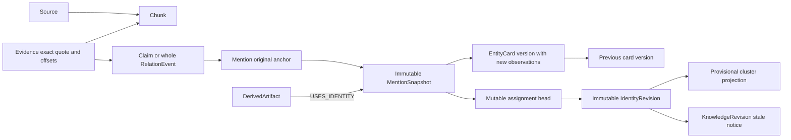

# Universal knowledge intelligence: executable foundation and boundaries

F increment1 adds an implemented bounded identity blocking/assessment layer;
see MILESTONE_F_REPORT. Operator-authorized source evidence is separate from
ordinary upload content. New F-mode initial projection anchors are distinct for
untrusted IDs. No overlay joins definitive inference; general wrong-merge detection
and domain-pack concepts below were unimplemented at that checkpoint.

F increment2 now implements manifest-checked indexed cluster audits, bounded
negative constraints, default dry-run proposals and separately enabled automatic
provisional merge/partition. Authority evidence is an operator/connector assertion,
not external registry verification. Unknown/transitively conflicting/incomplete
clusters abstain; source types alone do not authorize auto splits. Evidence,
heads, immutable revisions and exact registered stale notices share one atomic
write. Base facts/events are never rewired. See MILESTONE_F_REPORT for actual
graph evidence, bounds, zero public positive recall and deferred optional packs.
Older E sections below remain architectural history, superseded by this F note.

October16,2026, after D commit9c319ea2770174747386fc31a054bc0bb9997b5e and
[successful CI](https://github.com/divyashy20-boop/graph-hacks-2026/actions/runs/38831854118).
This extends the working converter; it is not a replacement engine or a claim
that every component below is implemented. Code and synthetic tests, not diagrams,
determine capability. No paid model or imported project1 code is required.
Foundation checkpoint1b4a549f6ce5ab6383e08b99a8ace0b98aa94a97 has
[verified hosted CI](https://github.com/divyashy20-boop/graph-hacks-2026/actions/runs/38832961856).

## 1. Existing versus new

`extract.py` parses typed/structured records or bounded text/model proposals;
`engine.py` grounds binary assertions, resolves conservative identities and runs
bounded graph-grounded investigations; `nary.py` verifies entire role sets;
`store.py` persists atomic documents in tenant/dataset-specific FalkorDB graphs.
Existing Mention records refer to source/chunk, but Entity is a mutable latest
name/alias view. Existing MergeDecision is a name-collision review candidate,
**not an executed identity union**. Hypothesis reevaluation is not a general
knowledge-revision log. API and MCP retain their existing authorization policies.

This increment implements an opt-in, automatically populated mention/card ledger,
reversible **provisional identity projection**, and one targeted freshness demo.
It deliberately does not rewire Claim endpoints or activate cross-identity
inference. That is the handover's permitted ledger/projection-first scope.
Domain packs/open-schema induction and advanced autonomous wrong-merge detection
are designs below, not shipped capabilities. Routine uncertain inputs never wait
for human approval: they remain separate/unresolved automatically.

## 2. Universal meta-model, not universal vocabulary



Solid concepts above are implemented core/ledger concepts, not literal names of
every persisted edge. Snapshot/card/history references live in payloads; only
dependency reverse lookup uses a new USES_IDENTITY edge. EntityGroup, DomainPack,
PredicateDefinition and TOOL_OBSERVED remain planned. RelationParticipant already
exists as a validated role record embedded in RelationEvent, not a separate node.
Investigation/AgentAction/Hypothesis remain existing core records.

## 3. Immutable observations and reconstructible cards

With `UGI_IDENTITY_LEDGER=true`, accepted binary/event mentions generate snapshots,
initial identity assignments and delta cards in the **same atomic source write**.
The setting defaults off to preserve existing datasets/performance and makes the
prototype opt-in, not universal migration. Enabling it requires no per-mention
review. Duplicate uploads add nothing. Legacy sources are not silently backfilled:
their old mutable Entity record cannot reconstruct historical profile attributes.

Example payload shapes (IDs abbreviated; actual IDs are hashes):

```json
{"kind":"MentionSnapshot","id":"ms1","mention_id":"m1","entity_id":"e1",
 "text":"ACME Corporation","entity_type":"Organisation","external_id":"registry:123",
 "source_id":"s1","chunk_id":"c1","dependent_record_id":"claim1",
 "recorded_at":"2026-10-16T00:00:00+00:00"}
```

```json
{"kind":"EntityCard","id":"card2","entity_id":"e1","version":2,
 "previous_id":"card1","mention_snapshot_ids":["ms2"],"recorded_at":"..."}
```

Cards contain only that upload's immutable observations, not repeatedly copied
full histories. EntityCardHead is an O(1) ID lookup; bounded parent traversal
reconstructs prior versions. An identity projection reports each mention's
current cluster plus original entity anchor. Changing a cluster never mutates
the source mention, evidence, card or Claim/RelationEvent.

Snapshot identifiers, source hashes and record dependencies are provenance, not
real-world identity certification. Explicit IDs currently have tenant/type scope,
not a globally verified registry. Bad/reused upstream IDs can still misanchor
the legacy base graph. The ledger exposes/reverses provisional projections; it
does not silently repair the existing reasoner's explicit-ID assumptions.

## 4. Identity decisions and reversible change

Initial assignments distinguish source-supplied typed IDs from document-local
anchors. Same typed explicit ID can link renamed mentions; matching names alone
never link across documents. Type/ID conflicts are not resolved by fuzzy score.
No arbitrary all-card pair comparison or LLM self-confidence threshold is used.

Explicitly authorized prototype merge/split operations append immutable revisions
with request hash/idempotency key, algorithm version, actor, reason, source snapshot
IDs, previous decision/cluster per mention and affected Claim/Event IDs. They are
**provisional** even when authorized, never evidence of identity truth. Reversal
is a compensating revision; it requires the original revision still be current
for all its mentions, preventing undo from clobbering later decisions. History
and evidence remain readable. Readers may reconstruct assignments at a system
timestamp through the previous-revision chain; all traversal has hard budgets.

Autonomous mistake detection needs more than this ledger: typed identifier
authority/uniqueness, blocked candidate retrieval, pairwise evidence features,
cluster consistency constraints and labelled split/merge calibration. A new city
or employer alone is not an identity contradiction. Medium/weak matches stay
soft/unresolved and excluded from definitive inference. Automatic correction is
not claimed here; the reversible primitive is an auditable foundation for it.

## 5. Dependencies, revision and two timelines

World validity stays on Claim/Event (`valid_from`, `valid_to`, `event_time`, precision,
historical). Ledger `recorded_at` describes system learning/decision time; a new
card is not evidence the company changed its name at that instant. `as_known_at`
on the ledger is distinct from the existing reasoner's world `as_of` date.

A DerivedArtifact explicitly declares which snapshot assignments it consumed.
An identity revision follows only USES_IDENTITY reverse edges (bounded), appending
a KnowledgeRevision stale notice. The original artifact/output is immutable.
Unrelated artifacts are untouched; freshness is computed from notices. Reversal
does not automatically restore freshness: re-evaluation must create a new output.
This is stale detection/queue metadata, not automatic semantic recomputation or
general Claim revocation. Cycles are avoided by accepting snapshot inputs only
in this prototype. General dependency DAG traversal will need a visited set,
total expansion budget and explicit partial-result status.

## 6. Domain packs and open predicates — specified, not implemented

Use versioned JSON validated with Pydantic, no eval, imports, executable hooks,
arbitrary Cypher, templated filesystem access or network fetch. Pack identity is
namespace/version/content hash. Pin the pack version on every interpretation.
Allow entity types, directed predicates/definitions, aliases, roles/cardinality,
qualifier policies, source-field mappings and explicit cross-pack dependencies.
Reject ambiguous aliases, direction changes and unknown executable keys.

```json
{"schema_version":1,"namespace":"supply","version":"1.0.0",
 "predicates":{"PROVISION":{"definition":"source asserts a supply event",
 "roles":["provider","item","recipient"]}},"rules":[]}
```

An unrelated code pack may define CALLS(caller,callee) while sharing the same
meta-model. Do not interpret a supply-path as a code call. Existing structured
ingestion already retains arbitrary normalized predicate strings; that is not a
versioned semantic vocabulary registry or a two-pack proof of concept.

Planned lifecycle: exact open surface -> grounded proposed assertion -> definition
and argument roles -> candidate alignment -> provisional predicate registration
-> counterexample/qualifier checks -> versioned schema interpretation. Preserve
original wording, negation/modality/dates/direction and definition hash. Similar
embeddings generate candidates, not equality. Proposed/attempted/completed
acquisitions must not collapse. Provisional validity and SOURCE_ASSERTED are
separate dimensions. Copied sources do not count as independent corroboration.

Cross-pack bridges belong to an explicit global namespace or pinned dependency
pack, not whichever domain first encounters them. Sharing a Component identifier
does not establish causation. Rule proposals default disabled for definitive
inference; bounded typed path exposure can produce a hypothesis with assumptions,
not assert an actual service failure. Automatic soundness remains unsolved.

## 7. Groups, event roles and quantifiers

Keep whole RelationEvents. Google/Microsoft/Amazon partnering with NVIDIA/Intel
describes scoped participant sets, not six independently asserted pairings.
Planned EntityGroup records need event ID, side/role, ordered/unordered membership,
collective/distributive interpretation, exact evidence, validity and uncertainty.
`respectively` requires explicit aligned ordered pairs; ambiguous or unequal lists
abstain. Existing event role sets are order-independent, so ordered group semantics
must use new explicit fields/versions, not silently reinterpret old events.
No A×B generation or BETWEEN binary projection. Repeated roles remain separate
participants; acquisition buyer/seller/target/price/time are not interchangeable.

## 8. Confidence, observations and safe agents

Retain SOURCE_ASSERTED/SOURCE_NEGATED, RULE_DERIVED, CONNECTED_ONLY, HYPOTHESIS,
CONTRADICTED and UNKNOWN. Separately represent span fidelity, identity evidence,
predicate/role support, source reliability, inference validity, temporal scope,
contradiction state and freshness. Current ledger reports categorical basis and
`calibrated=false`, **not an empirical numeric probability**. No calibration data
or independently annotated identity benchmark exists yet.

Planned TOOL_OBSERVED needs repository/commit/path, byte/line/symbol range, content
hash, tool/version and analysis conditions. AST-observed CALLS is not runtime
execution; dynamic dispatch/reflection must remain unresolved or overapproximated.
Tree-sitter can supply syntax; SCIP/LSIF/Kythe symbols and CodeQL/Joern deeper
analysis are candidates, not installed or benchmarked dependencies.
MCP's two write gates remain; new prototype REST revisions require explicit
authorization plus the existing tenant key. Loopback/no-key mode is local only.
No source text, pack or model suggestion can authorize external side effects.

## 9. Research choices and what was actually adopted

Primary references consulted; these are design comparisons, not reproductions:

| Reference | Useful boundary / decision |
|---|---|
| [ReVerb](https://aclanthology.org/D11-1142/), [OpenIE6](https://aclanthology.org/2020.emnlp-main.306/) | Open relation surface and coordination motivate retaining wording/roles; no downloaded extractor or accuracy claim |
| [EDC](https://aclanthology.org/2024.emnlp-main.548/) | Separate extraction, definition, canonicalization; planned registry, not instant synonym equality |
| [CESI](https://arxiv.org/abs/1902.00172) | Embeddings plus side information motivate candidate generation, not proof of identity |
| [iText2KG](https://github.com/AuvaLab/itext2kg), [GraphRAG](https://github.com/microsoft/graphrag), [LightRAG](https://github.com/HKUDS/LightRAG) | Incremental graph/retrieval approaches are relevant, not replacements for exact evidence or safe inference |
| [SKOS](https://www.w3.org/TR/skos-reference/), [SHACL](https://www.w3.org/TR/shacl/) | Distinguish vocabulary mappings from individual identity; validate shape separately from truth |

AutoSchemaKG, Wikidata properties, schema.org, FrameNet/PropBank and event-centric
semantics remain research candidates, not completed comparative evaluations. No
model/library is added for popularity. No project1 archive is copied; no credentials
or environment directories are imported. A broad literature survey would not
substitute for the real ledger tests requested here.

## 10. Compatibility, migration and scale

Existing IDs, payloads, binary/n-ary links, inference and dashboard remain valid.
The opt-in adds kinds/indexed reverse dependency edges, not SAME_AS Claim facts.
Immutable-ledger upserts must be byte-meaning-equivalent or reject atomically;
heads are replaceable views. Raw database administrators can bypass application
invariants: this is not a tamper-proof store. Old graphs are not rewritten.

Bound source counts, card versions, revision participants and dependency fanout;
exceeding a budget rejects without partial mutation, never returns a misleading
complete projection. O(1) head IDs and indexed reverse edges avoid full graph
search; history reconstruction is bounded linear in the selected entity's history.
Production will require paged indexed block search, typed authoritative identity
namespaces, append-log retention and tested invalidation workers. Opt-in ledger
overhead is measured separately; D's six fresh-chain results are **ledger off**.
No million-record capacity, arbitrary mixed-upsert scaling or general natural
language identity accuracy is claimed.

Actual dependency plan check: `MATCH (m:Record) WHERE m.id IN $ids ... WITH m`
anchors the bounded reverse traversal on the existing Record.id index. The real
integration test asserts GRAPH.EXPLAIN contains Index Scan. The earlier correlated
UNWIND form did not expose that plan; no timing/scalability gain is claimed from
this small hardening alone.
