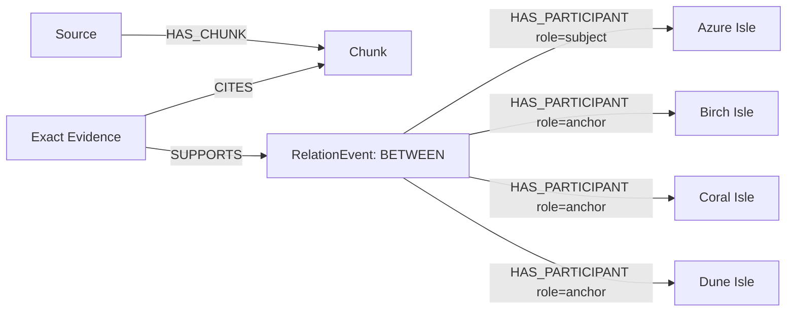

# Multi-participant relation model

Implemented during the October 15, 2026 continuation of the existing repository.
The event node represents a single sourced assertion, including negative,
attributed and possible assertions; it does not establish independent truth.



There are no A-B, A-D or A-F BETWEEN Claim records. Existing binary claims,
dependency traversal and persistent incident actions keep their previous shape.
Incidence edges do not imply friendship, collaboration, causation or a pairwise
spatial predicate. Original source/chunk and evidence offset scope each event ID;
canonical role sets remove order-only duplicates. Explicit occurrence identifiers
and exact offsets distinguish repeated occurrences. Dates are never ingestion time.

Core queries (values supplied through the existing parameter encoder):

```cypher
MATCH (e:RelationEvent)-[p:HAS_PARTICIPANT]->(n:Entity)
WHERE e.id=$event_id
RETURN e.payload,p.role,n.payload LIMIT 12
```

```cypher
MATCH (e:RelationEvent)-[:HAS_PARTICIPANT]->(:Entity {id:$entity_id})
RETURN DISTINCT e.payload ORDER BY e.id LIMIT 100
```

```cypher
MATCH (ev:Evidence)-[:SUPPORTS]->(e:RelationEvent {id:$event_id})
MATCH (ev)-[:CITES]->(chunk:Chunk)
RETURN ev.payload,chunk.payload LIMIT 1
```

New schemas: `EventParticipant`, `RelationEventCandidate`; optional `events` arrays
extend both full and local compact extraction envelopes. Existing binary-only
provider responses remain valid. Event candidates are grounded and checked before
the shared atomic source commit. Failed review preserves the complete proposed
event and reason in a ReviewTask, never a partial set of accepted role claims.

Known bounds: 3–12 participants, 6 local extracted events per response, at most
6 unresolved events in one reviewer batch. Overflows and provider failure abstain.
The model reviewer remains fallible and is explicitly labelled as such.

Demo: upload `demo/relation_events.txt` into an empty dataset and select a diamond
in the graph. Then use a different dataset for `demo/relation_events.json` to
inspect an attributed, uncertain contract proposal. The four textual examples
are authored demonstration fixtures, not independent accuracy evaluation.
